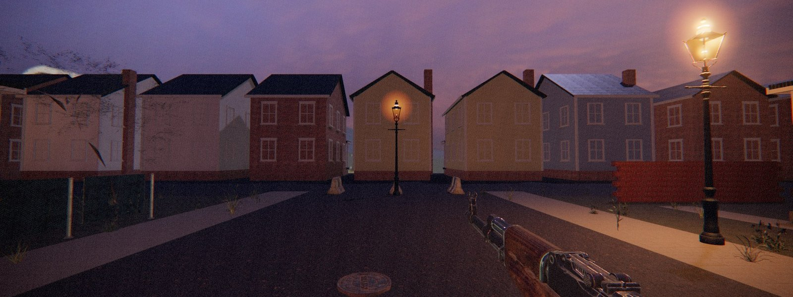
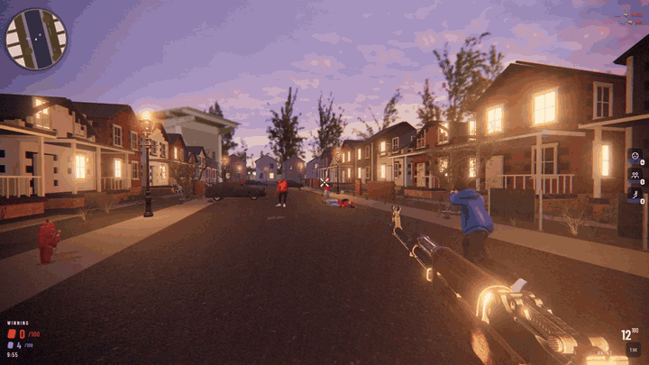
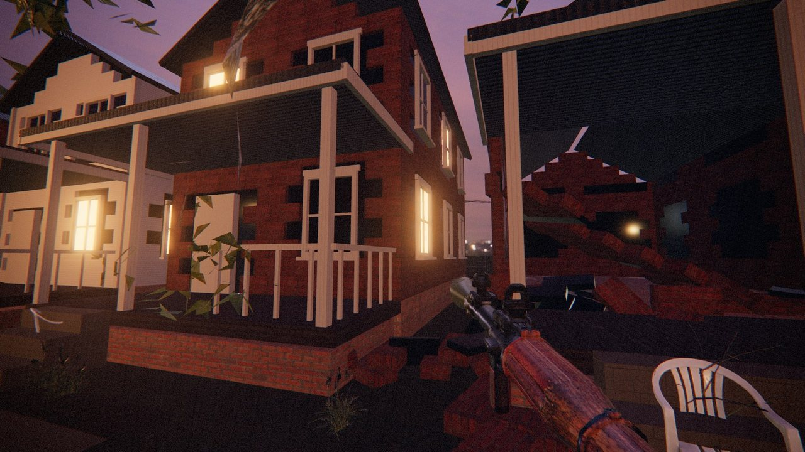
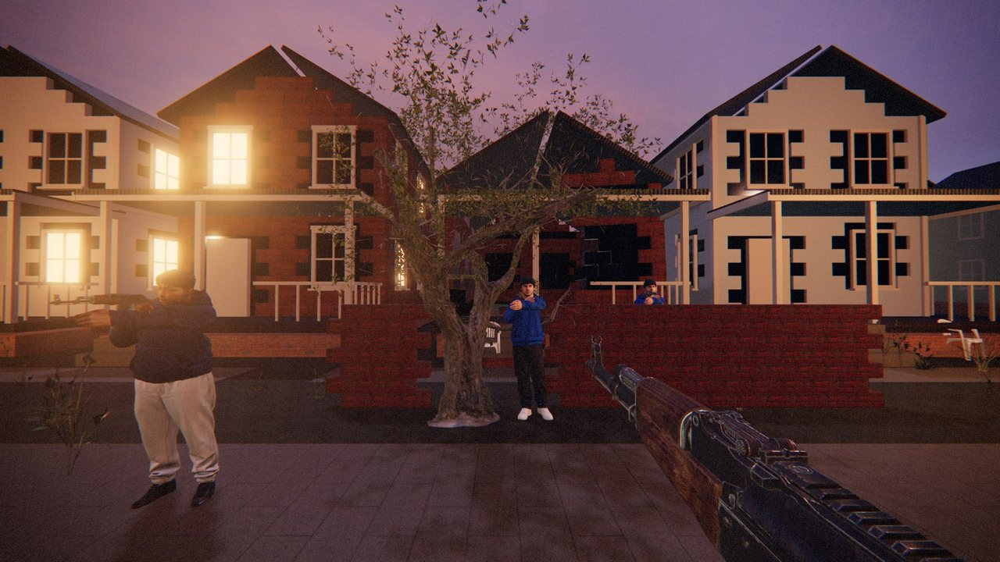
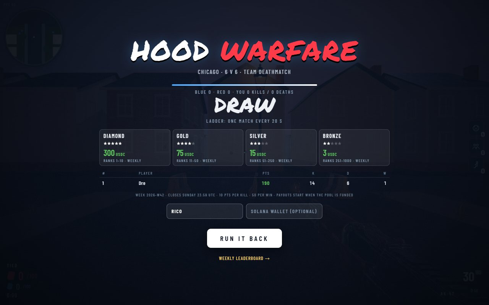
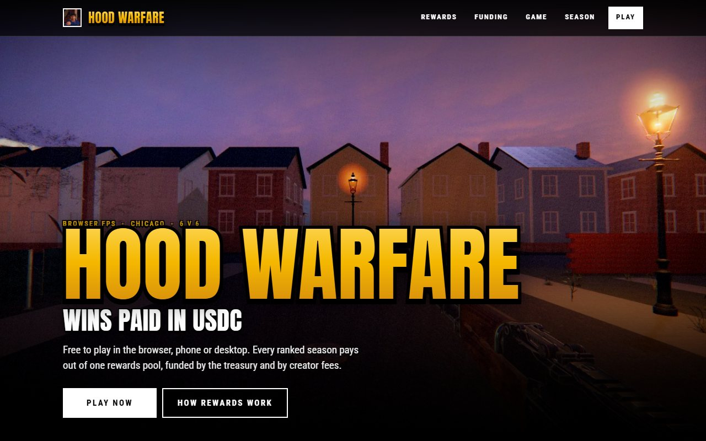
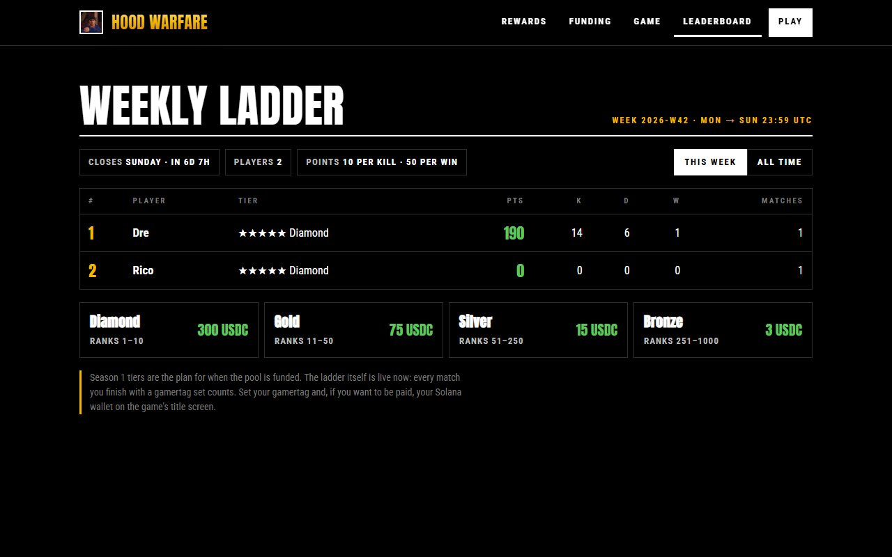

<p align="center">
  
</p>

<h1 align="center">MY HOOD</h1>

<p align="center">
  <b>Hoffman Estates holds the block. Downers Grove is coming in from the far end.</b><br>
  <sub>A private fork of Hood Warfare · 6v6 in the browser · the score stays on this machine</sub>
</p>

This fork is played on the house LAN. It does not post matches, wallets, or scores anywhere.
The upstream weekly USDC ladder is not part of this copy. Credit for the game, the block, and the
physics stays with [des35swim/hood-warfare](https://github.com/des35swim/hood-warfare).

<p align="center">
  
  
  
  
  
</p>

<p align="center">
  
</p>

---

## The game

A residential block in Hoffman Estates at blue hour. Downers Grove wears the gold, Hoffman Estates wears the orange, six a side. You carry an
AK-47 and an RPG-7. Kills charge three abilities:

| Key | Ability | What it does |
|:---:|---|---|
| **4** | Snitch | Marks every opp on the block for 12 seconds |
| **5** | Homies | Drops two of your crew at your back for 40 seconds |
| **6** | Bomber | Sends a runner at the nearest opp |

First team to 100 points, or the most when the ten minutes are up.

| Key | Weapon | Feel |
|:---:|---|---|
| **1** | AK-47 | 620 rpm, the all-rounder |
| **2** | RPG-7 | Rockets that open houses |
| **3** | MAC-10 | 1,090 rpm, close and loud |
| **7** | MP5 | 800 rpm, accurate on the move |
| **8** | M700 | Bolt-action sniper with a scope, one shot to the body |

`Q` or the mouse wheel cycles weapons; on a phone, SWAP cycles them.

<table>
  <tr>
    <td width="50%"></td>
    <td width="50%"></td>
  </tr>
  <tr>
    <td><b>Destruction.</b> 20 houses and 14 garden walls, 12,852 welded bricks and panels. A rocket tears the welds where it lands.</td>
    <td><b>Crews.</b> Four original hoodie characters, rigged and animated, rifles held with two-bone IK.</td>
  </tr>
</table>

## How it is built

| Layer | What runs |
|---|---|
| **Rendering** | Three.js r186 (WebGL2), ACES tone mapping, a Poly Haven night-sky HDRI for image-based light, Victorian lamps as real point lights, texel-snapped shadows, bloom and a film grade pass. Pixel budget scales the resolution to hold the frame rate. |
| **Destruction** | [three-avbd](https://github.com/sbobyn/three-avbd) (Augmented Vertex Block Descent) running headless on WebGPU beside the WebGL renderer. Bricks are welded with break-on-pull joints; poses are read back every step into instanced meshes. Roofs drop when nothing holds them. |
| **Characters** | Generated in Tripo from original references, retopologised to 10k quads, auto-rigged for Mixamo, one shared animation set. |
| **Effects** | Bullets fly as short streaks at 540 m/s with a bright tracer every third round. Explosions layer a flash, a fireball of photographic flame billows, a black smoke column lit from inside, a ground dust ring, brick debris on real arcs, embers, a scorch mark and camera shake (Kenney Smoke Particles, CC0). |
| **Sound** | 20 effects generated with ElevenLabs, positioned in 3D around the listener. |
| **Bots** | Grid A* navigation, line-of-sight perception, burst fire, team spawns and respawns. |
| **Controls** | Mouse and keyboard on desktop; twin-stick touch with safe-area insets on phones. |
| **Ladder** | Cloudflare Worker + D1. Ranked results post at match end; 10 points per kill, 50 per win, weeks run Monday to Sunday UTC. |

Plain ES modules, no bundler, no build step. Runs at 60 fps on desktop and on an iPhone 15 Pro Max.

## Weekly ladder and rewards

<p align="center"></p>

| Tier | Ranks | Weekly reward |
|---|---|---|
| ★★★★★ Diamond | 1–10 | 300 USDC each |
| ★★★★ Gold | 11–50 | 75 USDC each |
| ★★★ Silver | 51–250 | 15 USDC each |
| ★★ Bronze | 251–1,000 | 3 USDC each |
| Bounty | MVP of a ranked match | 1.50 USDC |
| Bounty | Rampage (4 kills in 4 s) | 0.75 USDC |

All rewards come from one pool, funded by the treasury and by creator fees. Payouts never exceed the pool. Tiers are
set from the pool when a season opens, can grow between seasons and never shrink mid-season. Paid in USDC on Solana
to the wallet you played with.

<table>
  <tr>
    <td width="50%"></td>
    <td width="50%"></td>
  </tr>
  <tr>
    <td align="center"><sub>Landing page (<code>site/index.html</code>)</sub></td>
    <td align="center"><sub>Public leaderboard (<code>site/leaderboard.html</code>)</sub></td>
  </tr>
</table>

## Run it

```bash
python serve.py 5441
```

Open http://127.0.0.1:5441/ for the game and http://127.0.0.1:5441/site/ for the landing page.
The bundled server queues 512 connections because the game loads around 150 files at once.

| Controls | |
|---|---|
| Move / sprint / jump / crouch | `WASD` · `Shift` · `Space` · `C` |
| Fire / aim / reload | left click · right click · `R` |
| Weapons | `1` AK-47 · **`2` RPG-7** · `3` MAC-10 · `7` MP5 · `8` M700 · `Q` / wheel cycles |
| Abilities / mute | `4` `5` `6` · `M` |

Useful URL flags: `?sky=the_sky_is_on_fire`, `?phys=0` (no GPU physics), `?nohud=1`, `?mobile=1`, `?api=<ladder url>`.

## Deploy

```bash
python tools/build-netlify.py        # deploy/hood-warfare-netlify-latest.zip: landing at /, game at /play/
cd worker && npx wrangler deploy     # ladder API (D1 schema in worker/schema.sql, tests: node worker/test.mjs)
```

## Repository map

```
index.html, src/        the game (main loop, world, destruction, weapons, bots, HUD, ladder panel)
site/                   landing page + leaderboard
worker/                 Cloudflare Worker + D1 ladder API
assets/                 characters, models, sounds, fonts, textures, skies
vendor/                 three.js r186, three-avbd 0.3.0
qa/                     headless Playwright checks and the demo recorder
docs/                   README images, DEVLOG.md (build history), STUDY-three-avbd.md lives at the root
```

## Credits

Inspired by FearBuck's *Hood Warfare* video. Textures, skies and props from Poly Haven (CC0), AK-47 from stein-indie
(CC0), physics by sbobyn's three-avbd (MIT), rendering by Three.js (MIT). Full list in [CREDITS.md](CREDITS.md).
